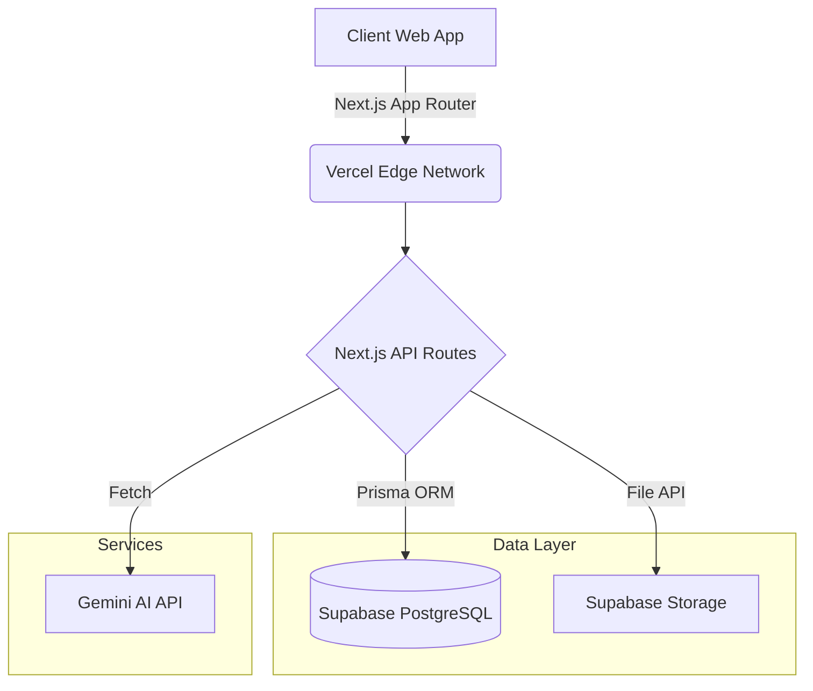
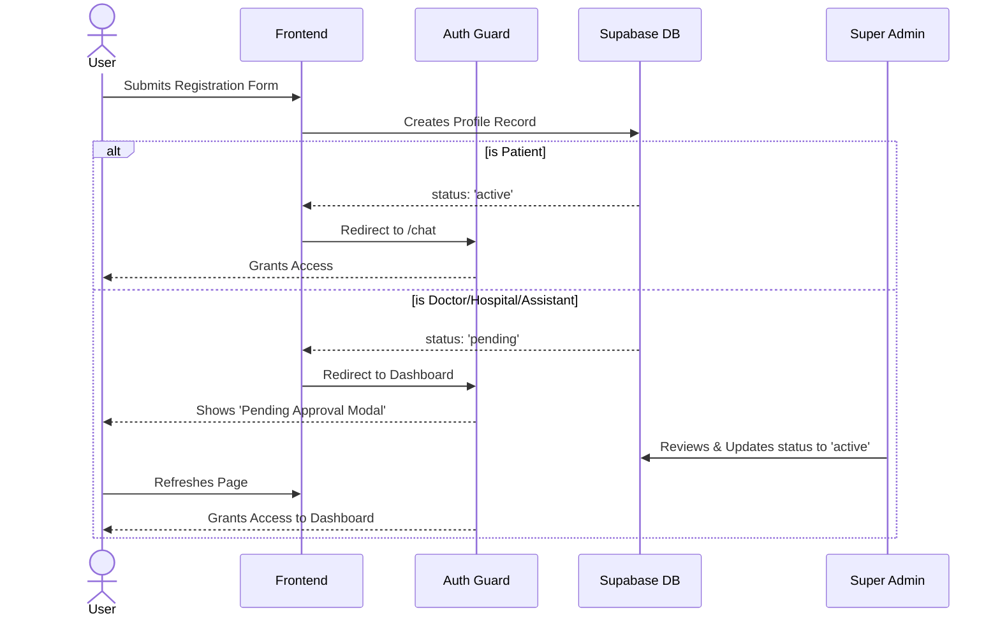
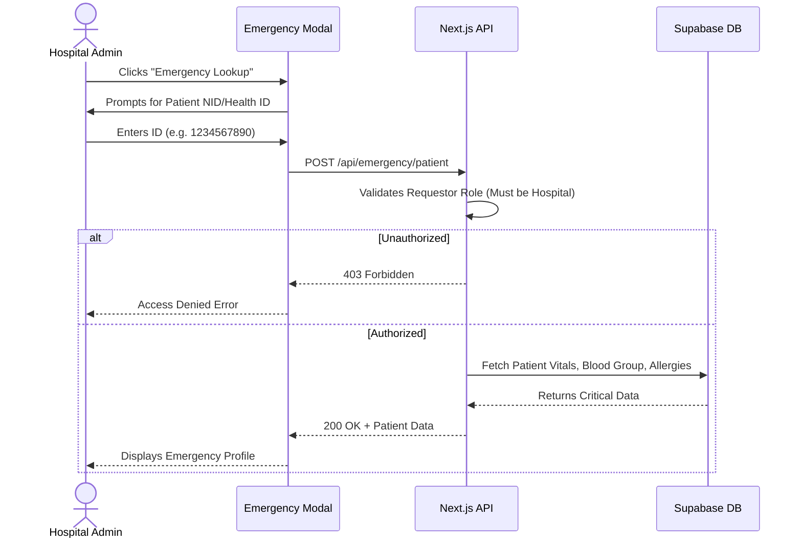
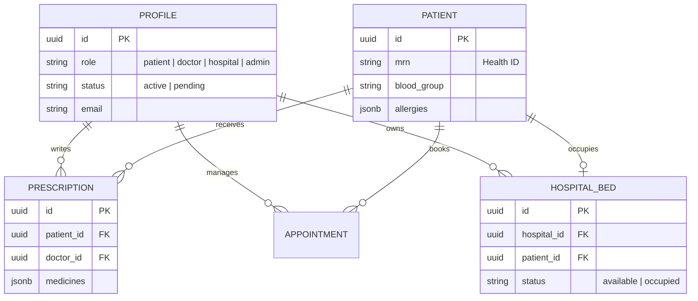
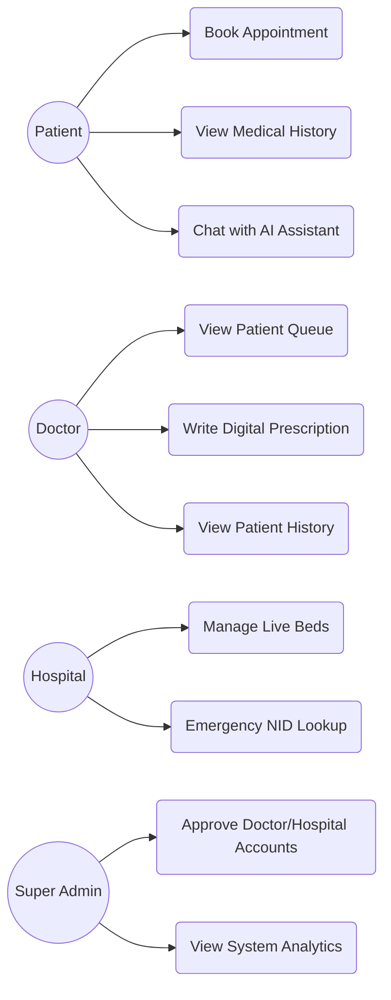

# 🏥 Oxpecker AI (Oxpecker AI)
> A centralized, intelligent healthcare platform connecting patients, doctors, and hospitals.

Oxpecker AI is built to solve fragmented medical records, inefficient serial management, and lack of critical data availability during hospital emergencies. By providing a **Universal Health ID**, patients can carry their entire medical history digitally, while hospitals can access life-saving data instantly during critical admissions.

---


## ⚡ High-Performance AI Inference: Nebius Token Factory & NVIDIA Nemotron

Oxpecker AI utilizes **Nebius Token Factory** high-performance inference cloud paired with **NVIDIA's Llama-3.1-Nemotron-70B-Instruct** model to achieve ultra-fast, hallucination-resistant clinical reasoning and emergency triage:
- **Inference Cloud:** Nebius Token Factory (`https://api.tokenfactory.nebius.com/v1`)
- **Foundational Model:** `nvidia/Llama-3.1-Nemotron-70B-Instruct-HF`
- **Clinical Alignment:** Grounded with Contextual RAG on 9,600+ validated cases and Directorate General of Health Services (DGHS) Bangladesh clinical guidelines.
- **Latency & Streaming:** Sub-second serverless token generation delivered through Next.js edge stream adapters.

## 🏗️ System Architecture



## 🔄 User Registration & RBAC Flow



## 🚨 Emergency Lookup Flow (Hospital Only)



## 🗄️ Entity Relationship Diagram (Core)



## 🧑‍🤝‍🧑 Use Case Flow



---

## 🔬 Lab Report Analyzer (Bengali-First) & Multi-Tenant B2B Healthcare SaaS

Oxpecker AI combines a deterministic Bengali diagnostic report explainer ("রিপোর্ট বুঝিয়ে দেওয়া + সঠিক ডাক্তারের কাছে পৌঁছে দেওয়া") with a multi-tenant B2B SaaS platform for clinics, diagnostic labs, and hospitals:

- **Deterministic Reference-Range Engine:** Code assigns flags (`স্বাভাবিক` / `কম` / `বেশি`) across CBC, HbA1c, FBS/RBS (`mg/dL` & `mmol/L`), Lipid Profile, Creatinine + CKD-EPI eGFR, LFT, TSH, Vitamin D, and Urine R/E—never delegated to LLMs. Lab-printed reference ranges take precedence when available.
- **Hard AI Safety Guardrails:** Critical values/symptoms trigger an emergency `999` override banner first; definitive diagnosis phrases or unmeasured accuracy percentages are rejected/sanitized and logged.
- **Longitudinal Trends & Doctor Review Loop:** Compare repeated tests (e.g., `HbA1c` across dates), generate 24-hour expiring share links, and let registered doctors verify summaries with `"ডাক্তার যাচাই করেছেন"` badges while keeping full edit history.
- **Multi-Tenant B2B SaaS & Directory Routing:** Workspace quotas (`free`, `clinic_starter`, `clinic_pro`, `lab_enterprise`), bKash/Nagad/SSLCommerz sandbox checkout, consent-gated specialist leads (`/doctors?specialty=...`), clinic-branded PDFs, OpenAPI 3.1 (`/api/saas/workspace?openapi=1`), and webhooks.

### 🧪 Run Tests Locally
```bash
cd Frontend
npx prisma generate
npm test
npm run lint
npm run build
```

### ⚡ 60-Second Judge Demo Route
Open **`/demo`** (publicly accessible without login gates) or navigate from `/reports`:
1. Inspect the seeded Health ID **`HP-2026-8841`** and click **"১-ক্লিক ডেমো ল্যাব রিপোর্ট বিশ্লেষণ"**.
2. Review deterministic green/amber/red flags, **"কেন এই ফলাফল"**, Bengali explanations, and multi-visit HbA1c trend charts.
3. Toggle **"ডাক্তার যাচাই করুন"** to stamp `"ডাক্তার যাচাই করেছেন"` with preserved AI edit history.
4. Click **"কোন ডাক্তার দেখাবেন"** to open filtered Bangladesh specialists (`/doctors?specialty=Endocrinology`) and submit a consent-gated consultation request.

---
*Built securely for the citizens of Bangladesh.*
