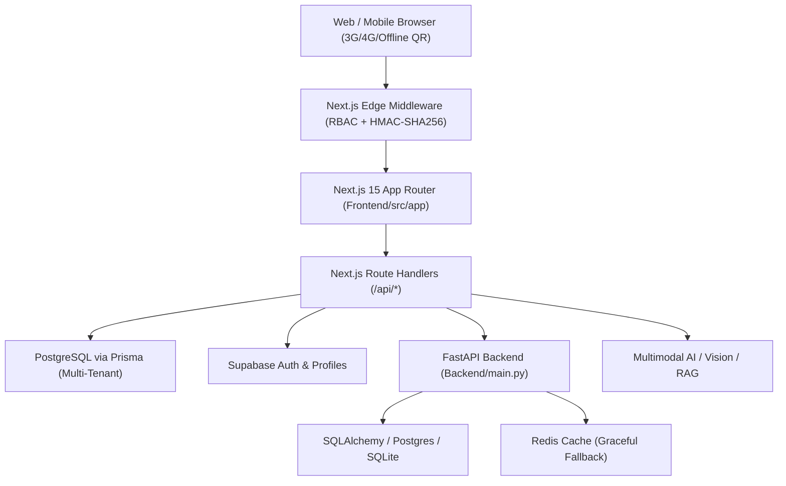

# 04. Technical Requirements Document (TRD) — Oxpecker AI

| Metadata | Value |
| :--- | :--- |
| **Frontend Runtime** | Next.js `15.5.20` (App Router, `output: 'standalone'`), React `19.0.0`, TypeScript `5` |
| **Backend Runtime** | Python `3.13`, FastAPI, Pydantic v2 (`ConfigDict`), SQLAlchemy / Alembic |
| **ORM & Database** | Prisma `5.22.0` (PostgreSQL) + Supabase JS (`2.112.3`) |

---

## 1. Technology Stack & Runtime Topology

---

## 2. Multi-Tenancy Technical Model

- **Strategy:** Shared-schema multi-tenancy anchored by `Organization` (`id`, `slug`, `name`, `type`) and an indexed `organizationId` column (default `"org-default"`) across `User`, `HealthPassCard`, `AuditLog`, `AutomationEvent`, `HmsBooking`, `HmsAdmission`, `HmsBill`, `Patient`, `Prescription`, `MedicalDocument`, `Doctor`, `Hospital`, and `Appointment`.
- **Enforcement:**
  1. `signSessionToken` embeds `organizationId` inside the HMAC-SHA256 `oxpecker_session` cookie.
  2. API handlers extract `auth.user.organizationId` via `requireSessionUser(req)`.
  3. Non-`admin` users can only query/mutate records matching their `organizationId`.

---

## 3. Bandwidth, Caching & 3G Optimization

Configured in `Frontend/next.config.ts`:
- **Compression:** `compress: true`, `poweredByHeader: false`.
- **Static Asset Cache Headers:**
  - `/api/medicines/:path*` → `Cache-Control: public, s-maxage=3600, stale-while-revalidate=86400`
  - `/(images|placeholders|data)/:path*` → `Cache-Control: public, max-age=86400, stale-while-revalidate=604800`
- **Image Payload Discipline:** All 21 oversized PNG/JPG assets in `Frontend/public/images/` and `Frontend/public/placeholders/` are compressed to `40–381 KB` (down from `1.2–3.9 MB`).
- **Offline Continuity:** `healthpass-offline-qr.ts` executes pure-TypeScript FIPS 180-4 SHA-256 + RFC 2104 HMAC-SHA256 synchronously in-browser with zero external network calls.

---

## 4. Environment & Secret Configuration Matrix

> **Security Rule:** Secret *values* are never committed. Below are the verified variable names read by `Frontend/` and `Backend/`.

| Variable Name | Service | Required in Prod? | Purpose |
| :--- | :--- | :---: | :--- |
| `DATABASE_URL` | Frontend (Prisma) / Backend | Yes | PostgreSQL connection string |
| `AUTH_SESSION_SECRET` | Frontend (`server-auth.ts`) | Yes | HMAC-SHA256 key for `oxpecker_session` cookies |
| `MEDICAL_DOCUMENT_ENCRYPTION_KEY` | Frontend (`medical-document-server.ts`) | Yes | 32-byte AES-256-GCM key for medical document vault |
| `HEALTHPASS_QR_SECRET` / `NEXT_PUBLIC_HEALTHPASS_QR_KEY` | Frontend (`healthpass-offline-qr.ts`) | Recommended | Signing key for `YUNET1:` offline QR payloads |
| `SECRET_KEY` | Backend (`config.py`) | Yes | FastAPI JWT signing key (enforced outside `dev`/`test`) |
| `ENVIRONMENT` | Backend (`config.py`, `auth.py`) | Yes | `development` vs `production` (controls `Secure` cookie flag & `SECRET_KEY` check) |
| `NEXT_PUBLIC_SUPABASE_URL` / `NEXT_PUBLIC_SUPABASE_ANON_KEY` | Frontend | Optional | Supabase auth & profile synchronization |
| `NEXT_PUBLIC_API_URL` | Frontend | Optional | FastAPI backend base URL (default `https://oxpecker-api.azurewebsites.net`) |
| `OPENAI_API_KEY` / `GEMINI_API_KEY` / `AZURE_OPENAI_API_KEY` | Frontend (`ai/*`, `vision-engine.ts`) | Optional | AI chat, triage, and multimodal OCR providers |
| `REDIS_URL` | Backend (`config.py`) | Optional | Redis cache/broker (gracefully bypassed if offline) |
