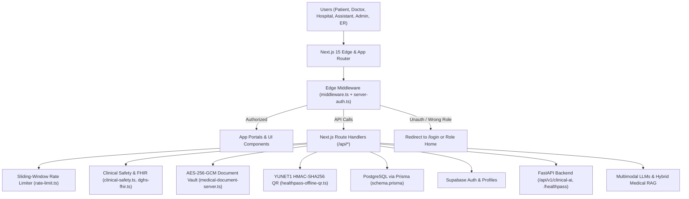
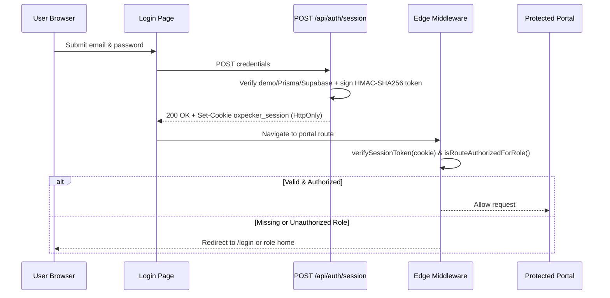
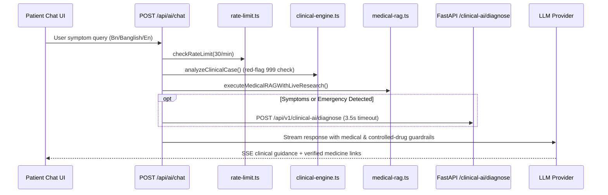
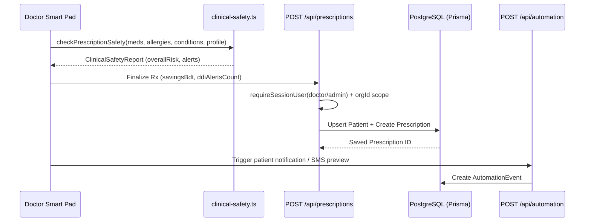
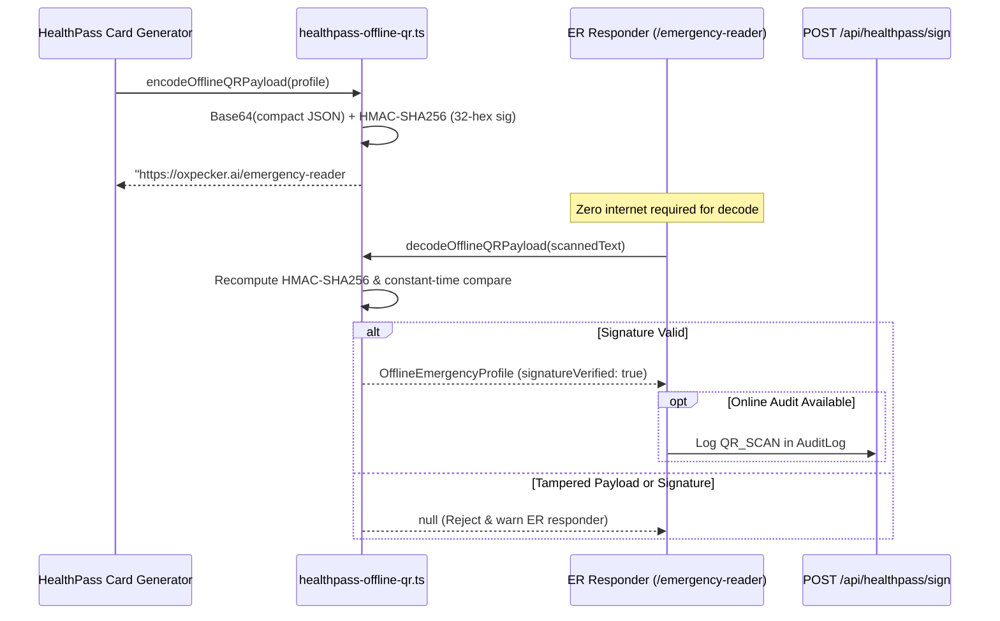

# 05. Architecture (HLD & LLD) — Oxpecker AI

---

## 1. High-Level Architecture (HLD)

---

## 2. Low-Level Module Breakdown

| Layer | Module Path | Responsibility |
| :--- | :--- | :--- |
| **Edge Security** | `Frontend/src/middleware.ts`, `Frontend/src/lib/rbac.ts` | Intercepts protected portal routes, verifies `oxpecker_session`, enforces `ROLE_EXCLUSIVE_ROUTES` |
| **Session Auth** | `Frontend/src/lib/server-auth.ts`, `Frontend/src/app/api/auth/session/route.ts` | WebCrypto HMAC-SHA256 token signing/verification, `requireSessionUser(req, roles)` |
| **Clinical Safety** | `Frontend/src/lib/clinical-safety.ts` | Duplicate therapy, DDI rules, allergy cross-reactivity, pregnancy/pediatric/renal/hepatic contraindications |
| **Rx Intelligence** | `Frontend/src/lib/prescription-intelligence.ts`, `Frontend/src/lib/prescription-ocr.ts` | OCR normalization, fuzzy brand/strength/form matching, exact paisa pricing |
| **Offline QR** | `Frontend/src/lib/healthpass-offline-qr.ts`, `Frontend/src/app/api/healthpass/sign/route.ts` | Synchronous SHA-256 + HMAC-SHA256 `YUNET1:` QR encoding, decoding, and `QR_SCAN` audit logging |
| **FHIR Export** | `Frontend/src/lib/dghs-fhir.ts`, `Frontend/src/lib/dghs-atc-data.ts` | HL7 FHIR R4 `Bundle` (`Patient` + `MedicationStatement`) with WHO ATC codes |
| **Vault** | `Frontend/src/lib/medical-document-server.ts` | Magic-byte validation + AES-256-GCM encrypt/decrypt + owner-scoped access |
| **FastAPI Engine** | `Backend/app/api/v1/clinical_ai.py`, `Backend/app/api/v1/healthpass.py` | Clinical AI diagnosis (150 diseases / 9,600 cases) & biometric face-match similarity |

---

## 3. Critical Sequence Diagrams

### 3.1 HMAC-SHA256 Session Login & Edge RBAC

### 3.2 AI Multimodal Clinical RAG Pipeline

### 3.3 Doctor Prescription Finalize → Safety → Persistence → Automation

### 3.4 Air-Gapped `YUNET1:` Offline QR Sign & Decode

