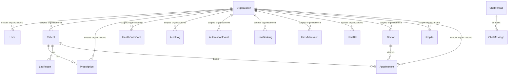

# 06. Database Schema & Data Dictionary — Oxpecker AI

Source of truth: [schema.prisma](file:///e:/Oxpecker-AI-main/Oxpecker-AI-main/Frontend/prisma/schema.prisma) (`Prisma 5.22.0`, PostgreSQL).

---

## 1. Entity-Relationship Diagram (Mermaid)

---

## 2. Table-by-Table Data Dictionary

### 2.1 Multi-Tenant Core, Identity & Audit Models
| Model | Key Columns | Indexes | Purpose |
| :--- | :--- | :--- | :--- |
| **`Organization`** | `id` (PK, UUID), `slug` (Unique), `name`, `type` (`hospital`/`clinic`/`chamber`), `isActive` | `slug` | Root tenant boundary for B2B hospitals and clinics |
| **`User`** | `id` (PK), `email` (Unique), `name`, `passwordHash`, `role`, `status`, `organizationId`, `bmdcRegNo`, `bmdcStatus` | `[organizationId, role]`, `[bmdcStatus]` | Authenticated platform accounts & physician BMDC verification state |
| **`HealthPassCard`** | `id` (PK), `cardNumber` (Unique), `patientId`, `organizationId`, `fullName`, `nidNumber`, `phone`, `bloodGroup`, `allergies` (Json), `chronicDiseases` (Json), `medications` (Json), `qrSignature` | `[patientId]`, `[nidNumber]`, `[phone]`, `[organizationId]` | Smart HealthPass identity & offline QR source record |
| **`AuditLog`** | `id` (PK), `actorId`, `actorName`, `actorRole`, `organizationId`, `action`, `targetType`, `targetId`, `reason`, `metadata` (Json), `createdAt` | `[organizationId, createdAt]`, `[targetType, targetId]`, `[actorId, createdAt]` | Immutable compliance trail (`EMERGENCY_LOOKUP`, `QR_SCAN`, `BMDC_VERIFY`, `PRESCRIPTION_ACCESS`) |
| **`AutomationEvent`** | `id` (PK), `organizationId`, `type`, `title`, `patientName`, `patientPhone`, `doctorName`, `channel`, `status`, `summary`, `smsPreview` | `[organizationId, createdAt]`, `[type]` | Clinical automation & patient notification dispatch log |

### 2.2 Hospital Management System (HMS) Models
| Model | Key Columns | Indexes | Purpose |
| :--- | :--- | :--- | :--- |
| **`HmsBooking`** | `id` (PK), `organizationId`, `patientName`, `patientPhone`, `doctorName`, `department`, `bookingStatus`, `paymentStatus`, `paidAmount`, `payload` (Json) | `[organizationId, createdAt]`, `[bookingStatus]` | Multi-tenant OPD appointment & consultation queue records |
| **`HmsAdmission`** | `id` (PK), `organizationId`, `patientName`, `smartCardUid`, `ward`, `bedNumber`, `status`, `payload` (Json) | `[organizationId, createdAt]`, `[status]` | IPD bed allocation & ward admission tracking |
| **`HmsBill`** | `id` (PK), `organizationId`, `patientName`, `totalAmount`, `paidAmount`, `status`, `payload` (Json) | `[organizationId, createdAt]`, `[status]` | Hospital inpatient/outpatient billing ledger |

### 2.3 Clinical Records, Vault & AI Models
| Model | Key Columns | Indexes | Purpose |
| :--- | :--- | :--- | :--- |
| **`Patient`** | `id` (PK), `mrn` (Unique), `organizationId`, `name`, `age`, `gender`, `phone` | `[organizationId, updatedAt]`, `[phone]`, `[name]` | Patient master index (`R 36 53 02` MRN format) |
| **`Prescription`** | `id` (PK), `patientId` (FK -> `Patient`), `organizationId`, `doctorId`, `doctorName`, `diagnosis`, `medicines` (Json), `advice`, `savingsBdt`, `ddiAlertsCount` | `[patientId, createdAt]`, `[organizationId, createdAt]` | Digital prescriptions with generic savings & DDI metrics |
| **`LabReport`** | `id` (PK), `patientId` (FK -> `Patient`), `name`, `type`, `date`, `status`, `pages`, `fileUrl` | `[patientId, createdAt]` | Patient diagnostic lab report metadata |
| **`MedicalDocument`** | `id` (PK), `ownerId`, `organizationId`, `kind`, `originalName`, `mimeType`, `analysis`, `priceComparison`, `image` (`Bytes`), `consentAt` | `[ownerId, createdAt]`, `[organizationId, createdAt]` | AES-256-GCM encrypted prescription/report binary & analysis vault |
| **`AiProvider`** | `id` (PK), `name`, `model`, `apiKey`, `priority`, `isEnabled`, `isDefault`, `usageCount`, `totalCost`, `healthOk` | — | Multi-provider LLM failover & telemetry configuration |
| **`ChatThread`** | `id` (PK), `userId`, `title`, `mode`, `language` | `[userId, updatedAt]` | Patient AI clinical consultation threads |
| **`ChatMessage`** | `id` (PK), `threadId` (FK -> `ChatThread`), `role`, `content`, `metadata` (Json) | `[threadId, createdAt]` | Individual turn history & structured RAG metadata |

### 2.4 Directory & Scheduling Models
| Model | Key Columns | Indexes | Purpose |
| :--- | :--- | :--- | :--- |
| **`Doctor`** | `id` (PK), `organizationId`, `name`, `degree`, `speciality`, `experience`, `hospital`, `consultationFee`, `languages` (Json), `availableSlots` (Json), `location`, `videoConsult`, `isActive` | `[speciality]`, `[organizationId]` | Verified doctor directory & booking availability |
| **`Hospital`** | `id` (PK), `organizationId`, `name`, `address`, `specialities` (Json), `hasEmergency`, `hasICU`, `hasNICU`, `bedAvailability`, `lat`, `lng` | `[name]`, `[organizationId]` | Hospital directory & emergency facility capabilities |
| **`DiagnosticCentre`** | `id` (PK), `name`, `address`, `packages` (Json), `homeCollection`, `lat`, `lng` | — | Diagnostic lab test & package catalog |
| **`Medicine`** | `id` (PK), `brandName`, `genericName`, `manufacturer`, `strength`, `price`, `availability`, `dosageForm`, `warnings` (Json), `alternatives` (Json) | `[brandName]`, `[genericName]` | DGDA-aligned medicine & generic pricing catalog |
| **`Appointment`** | `id` (PK), `organizationId`, `patientId` (FK), `doctorId` (FK), `dateTime`, `type`, `status`, `paymentStatus` | `[organizationId, dateTime]`, `[patientId, dateTime]`, `[doctorId, dateTime]` | Patient-Doctor scheduled appointments |

---

## 3. Data Retention & Backup Strategy
- **Audit Trail (`AuditLog`):** Append-only; never cascade-deleted when patient/user records are archived.
- **Cascade Deletes:** `Patient -> Prescription`, `Patient -> LabReport`, `Patient -> Appointment`, and `ChatThread -> ChatMessage` use `onDelete: Cascade`.
- **Encrypted Binary Blobs (`MedicalDocument.image`):** Stored as ciphertext (`iv [12B] + authTag [16B] + encryptedBytes`); database snapshots alone cannot expose PHI without `MEDICAL_DOCUMENT_ENCRYPTION_KEY`.
